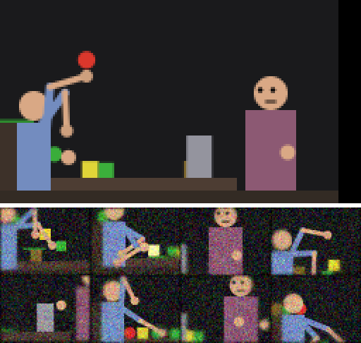

# A newborn's day in the nursery

Ultron as the newborn mind (`brain/newborn.py`: habituation, curiosity, comfort, memory of its days, sleep). Regenerated by `python -m ultron nursery`.

Seed 0, caregiver normal, 2 day(s) of 10,000 waking steps.

| What happened | Count |
|---|---|
| grasps | 267 |
| releases | 266 |
| lights | 67 |
| body touches | 684 |
| fussing | 980 |
| palm contacts | 18,704 |
| caregiver: arrive | 11 |
| caregiver: hand over | 19 |
| caregiver: heard crying | 6 |
| caregiver: hide | 14 |
| caregiver: idle | 14 |
| caregiver: leave | 10 |
| caregiver: look | 19 |
| caregiver: peekaboo | 5 |
| caregiver: press | 11 |
| caregiver: show | 18 |
| caregiver: stroke | 17 |

| Night | Kept in memory before sleep | after | Things it knows |
|---|---|---|---|
| 1 | 2,224 | 99 | 89 |
| 2 | 2,101 | 123 | 103 |

## Cost (this machine; not part of the deterministic record)

- 6.17 ms per step, 62 s per day of 10,000 steps, about 93 minutes for the 90 days of the Age 0 budget, with newborn as the mind

Top: the whole room at the end (noise-free, for people). Below: eight of Ultron's own views across the first day (what its eyes get, noise and all).
